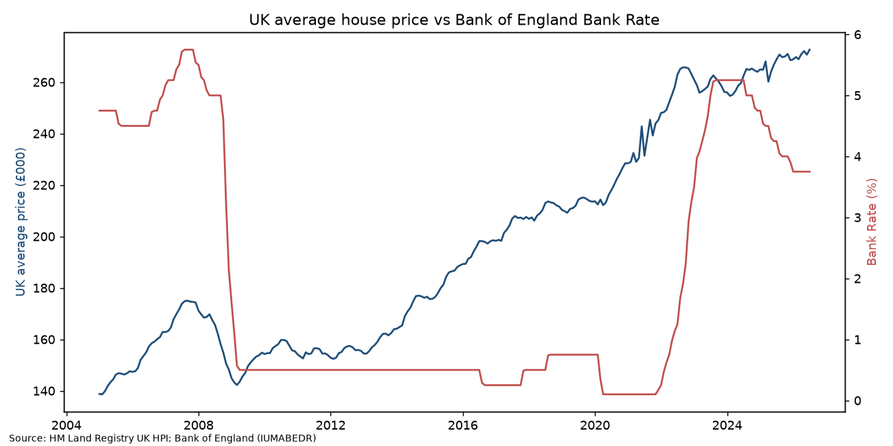
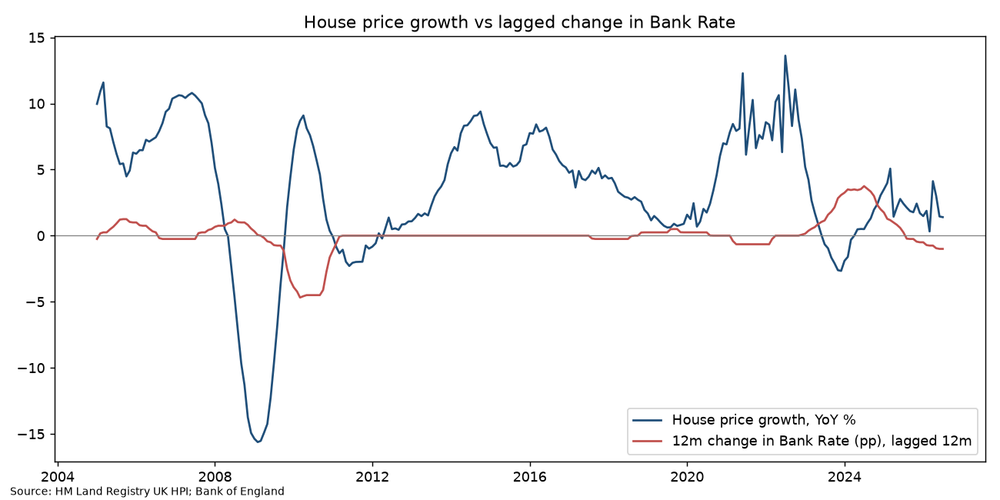

# UK House Prices vs Bank Rate (2005–2026)

**Question:** How closely do UK house prices respond to changes in Bank of England interest rates, and with what lag?

**Data (public, downloaded by `download_data.sh`):** HM Land Registry UK House Price Index full file (July 2026 release); Bank of England series IUMABEDR (monthly average Bank Rate). The 35 MB raw HPI file is git-ignored; the cleaned merged series is in `data/uk_hpi_bankrate_clean.csv`.

**Method (`analysis.py`, Python/pandas/statsmodels):** merged monthly UK average price with Bank Rate; computed year-on-year price growth and 12-month change in Bank Rate; cross-correlations at 0–24 month lags; OLS of price growth on the 12-month-lagged rate change with Newey-West (HAC) standard errors.

## Findings (computed from the data, Jan 2005 – Jul 2026)
- UK average price rose from **£138,759 to £272,611** (+96.5% nominal); July 2026 is the series peak.
- YoY growth ranged from **−15.6% (Feb 2009)** to **+13.6% (Jul 2022)**.
- Same-month correlation between price growth and rate changes is **positive (0.48)**: the Bank raises rates when the economy and housing are running hot, so naive correlation misleads.
- At a **12-month lag** the relationship turns **negative (−0.24)**. OLS: a 1pp rise in Bank Rate is associated with **0.90pp lower** house price growth a year later (p = 0.002), but **R² = 0.05**: rates alone explain little of price growth.
- During the 2021–23 tightening (avg Bank Rate 0.17% → 5.23%), recorded UK sales volumes fell **25.5%** from 2022 to 2023 (1,045,618 → 779,338; recent months subject to revision): the volume adjustment was far larger than the price adjustment.

**Limitations:** bivariate model, no controls for income, supply or credit conditions; nominal prices.

Run: `./download_data.sh && python3 analysis.py`
