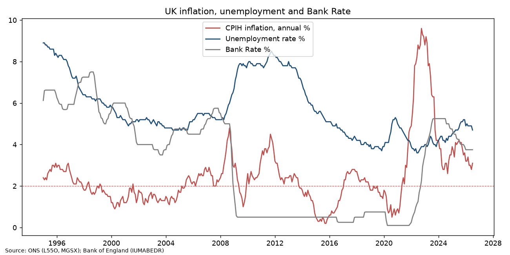
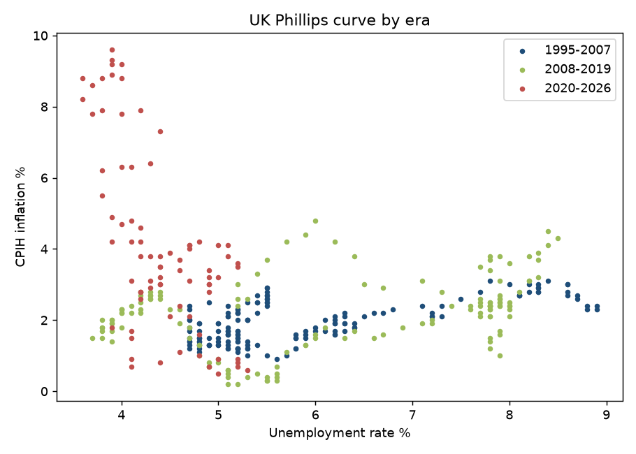

# UK Inflation, Unemployment and Bank Rate (1995–2026)

**Question:** Does the UK Phillips curve (inflation vs unemployment trade-off) still hold, and how quickly does the Bank of England respond to inflation?

**Data (public, `download_data.sh`):** ONS CPIH annual rate (L55O), ONS unemployment rate aged 16+, seasonally adjusted (MGSX), Bank of England Bank Rate (IUMABEDR). Cleaned monthly panel: `data/uk_macro_clean.csv` (Jan 1995 – Jul 2026, 379 months).

**Method (`analysis.py`):** parsed ONS time-series CSVs, aligned monthly; correlations and linear slopes of CPIH on unemployment by era; lead correlations between CPIH and future Bank Rate.

## Findings
- CPIH peaked at **9.6% in Oct 2022**; latest (Jul 2026) CPIH **3.1%**, unemployment **4.7%**, Bank Rate **3.75%**.
- Unemployment ranged from **8.9% (Jan 1995)** to **3.6% (Jun 2022)**.
- No stable textbook trade-off: the correlation was **positive** in 1995–2007 (0.65) and 2008–2019 (0.36), and only turned **negative (−0.64)** in 2020–2026, when the energy/supply shock coincided with a very tight labour market.
- CPIH first exceeded the 2% target in **May 2021**; the first rise in (monthly average) Bank Rate came in **Dec 2021**, about 7 months later.
- Correlation between inflation and Bank Rate *later* strengthens up to a **15–18 month lead (0.23)**, consistent with a lagged policy reaction.

**Limitations:** descriptive correlations, not causal estimates; no inflation-expectations or supply-shock controls.

