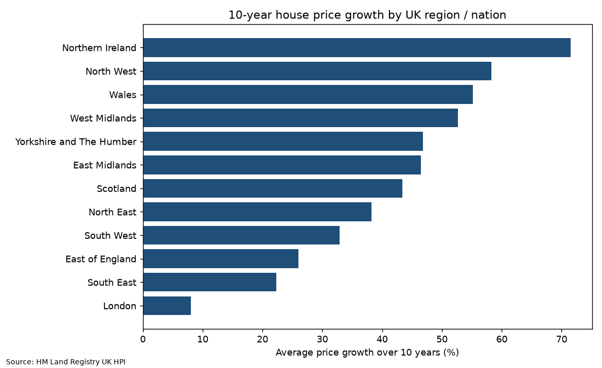
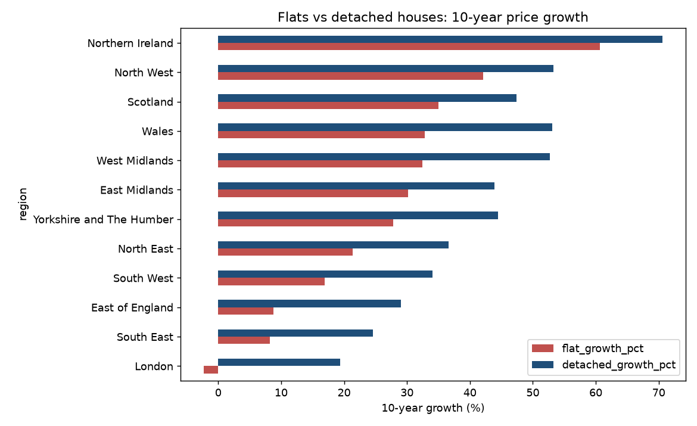

# Regional House Prices with SQL (UK HPI, 2016–2026)

**Question:** Which UK regions and property types have gained most over the last decade, and where are prices still below their 2022–23 peak?

**Data:** HM Land Registry UK HPI full file (July 2026 release), filtered to the 9 English regions plus Wales, Scotland and Northern Ireland. Cleaned table: `data/regional_hpi_clean.csv`.

**Method:** `load_and_run.py` loads the cleaned data into SQLite; all analysis lives in `queries.sql` (CTEs, self-joins on date offsets, correlated subqueries, aggregation). Query outputs: `results.md`.

## Findings (Jul 2016 → Jul 2026)
- **Northern Ireland (+71.5%)**, **North West (+58.3%)** and **Wales (+55.2%)** grew fastest; **London grew just 8.0%** (£509,080 → £550,037), the weakest of all 12.
- **London flat prices fell 2.3%** over ten years, while London detached houses rose 19.4%; flats lagged detached homes in every region.
- Four southern regions remain below their 2022–23 peak: **London −5.4%**, South West −3.8%, South East −2.8%, East of England −2.3%. All other regions are above it (North East +8.1%, Scotland +7.1%).
- England recorded sales: 1,053,532 in 2021 (stamp-duty holiday) vs **630,549 in 2023**, the lowest of 2015–2024.

**Limitations:** nominal prices; recent sales volumes are revised upward as registrations complete.

